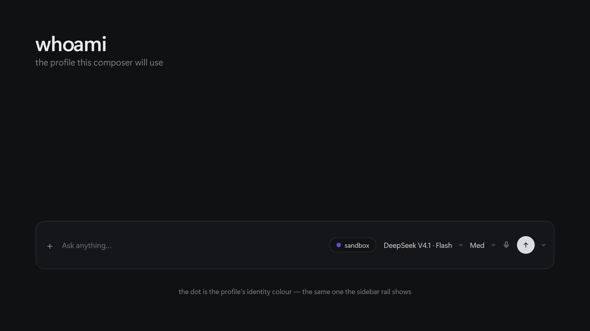
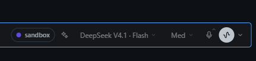
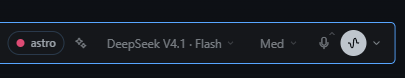
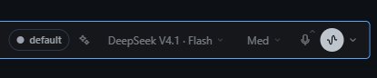

# Whoami

A Hermes Desktop plugin that shows which Hermes profile the composer will create a new session on.

## What it does

Whoami adds one surface: a coloured pill to the composer toolbar, next to the model pill, with the name of the active profile. The pill reads the live profile state, so the profile a new session will use is visible at a glance. When the app is in the all-profiles scope there is no active profile, and the pill shows a grey `no profile` instead.

## Screenshots

The pill takes the identity colour Hermes Desktop already gives the profile, so it matches the sidebar rail.









## Why

Hermes Desktop does not label the profile you are drafting in. With several profiles configured it is easy to start a session in the wrong one and only notice later. Whoami makes the target profile explicit before you send anything.

## Install

A catalog install puts the desktop half in `<hermes home>/desktop-plugins/whoami/`, with `plugin.js` at the root of that folder. The plugin folder name must be `whoami`.

In this repository the plugin entry lives under `desktop/`, so a manual install copies the **contents** of `desktop/` into the plugin folder — the loader reads `<plugins folder>/whoami/plugin.js`, not a `desktop/` subfolder:

```sh
git clone https://github.com/atostivint/hermes-whoami.git
cd hermes-whoami
mkdir -p "$HERMES_HOME/desktop-plugins/whoami"
cp -R desktop/. "$HERMES_HOME/desktop-plugins/whoami/"
```

On Windows, from the clone, with the default home (`%USERPROFILE%\.hermes\desktop-plugins\whoami\`):

```powershell
New-Item -ItemType Directory -Force "$env:USERPROFILE\.hermes\desktop-plugins\whoami" | Out-Null
Copy-Item "desktop\*" "$env:USERPROFILE\.hermes\desktop-plugins\whoami\" -Recurse -Force
```

Then open the command palette (`Command-K`, or `Ctrl+K` on Windows) and run
`Reload desktop plugins`.

`$HERMES_HOME` is usually `~/.hermes`. On a Linux server it is normally `/var/lib/hermes-agent/.hermes`. If you are unsure, open Settings -> Plugins, which shows the exact folder Hermes reads plugins from.

## Colours

The pill takes the profile's identity colour from Hermes Desktop, the same colour the sidebar rail shows, so the two always agree. There is no settings pane and nothing to configure: the plugin ships no colour UI.

The colour is resolved in this order, first hit wins — the built-in palette is the last resort:

1. `accent` mode, which paints the pill dot with `var(--ui-accent)` for every profile.
2. A preset or hex stored for that profile in `whoami.prefs`.
3. The colour Hermes Desktop itself shows for the profile: a hand-picked override from the rail
   (`hermes.desktop.profileColors` in `localStorage`), else the hue derived from the profile name.
4. The built-in eight-colour palette, used when the host build exports no `profileColor`.

Steps 1 and 2 stay honoured when an older install left a `whoami.prefs` behind — `{ "mode": "profile", "colors": { "work": "cyan" } }`, in the plugin storage namespace. Nothing in the current version writes that key, so a fresh install always shows the identity colour.

The root profile `default` gets no colour from the client — it renders that profile untagged and
ignores a hand-picked override for it — so it shows the neutral `mono` dot.

## Limitations

- **Read-only by design.** The SDK exposes `host.state.profile` but no profile-switch verb, so Whoami reports the scope and never changes it.
- Requires Hermes Desktop 0.21.5 or newer for the `composer.actions` area the pill is mounted in.
- If the pill shows a stale profile after a switch, open an issue with the values of `host.state.profile`.
- A colour picked in the rail does not repaint an already-mounted pill until the next render
  (profile switch or reload): a same-document `localStorage` write fires no event, and the plugin
  reads that key only while rendering.

## Development

Run `npm run check` to parse `desktop/plugin.js` without executing it. Run `npm run smoke` to exercise registration, rendering and colour logic offline with plain Node, no Hermes install and no React required. CI (`.github/workflows/smoke.yml`) runs both on every push and pull request.

## Uninstall

Delete the `whoami` folder from `$HERMES_HOME/desktop-plugins/` and reload desktop plugins.

## License

MIT
